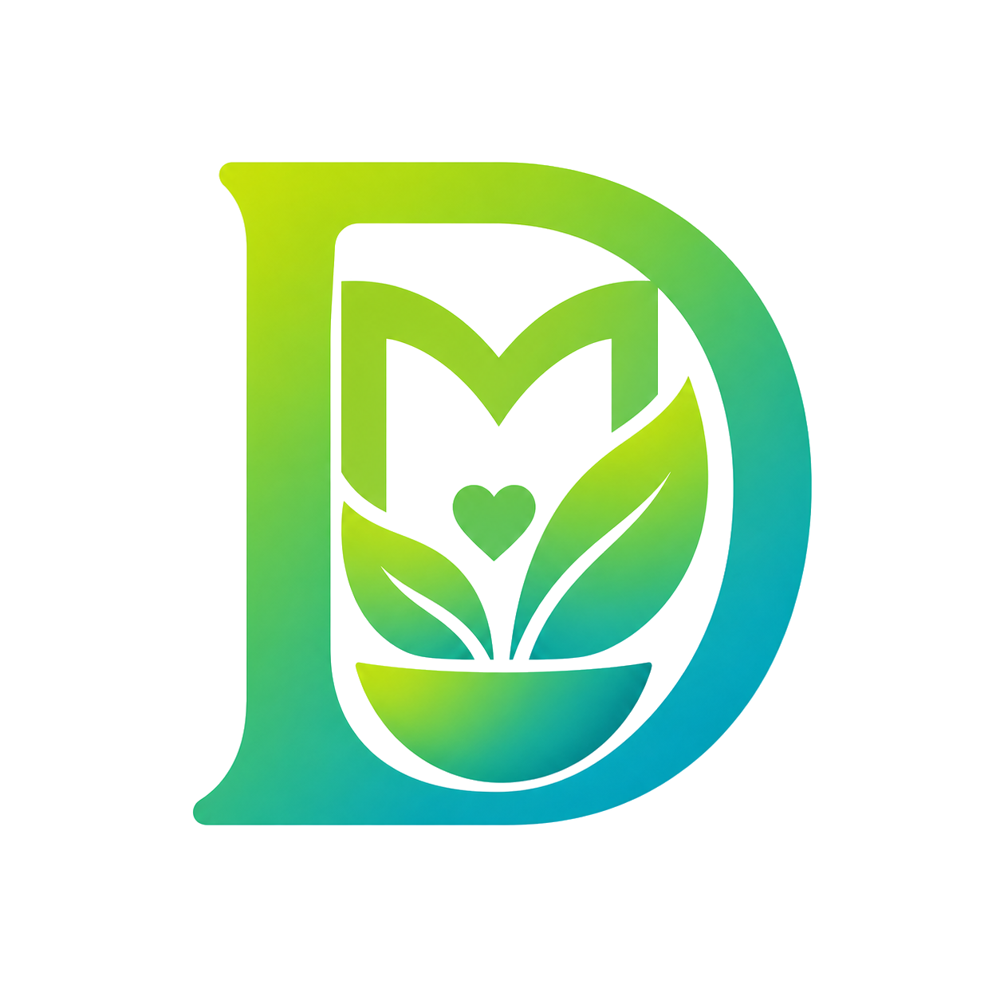
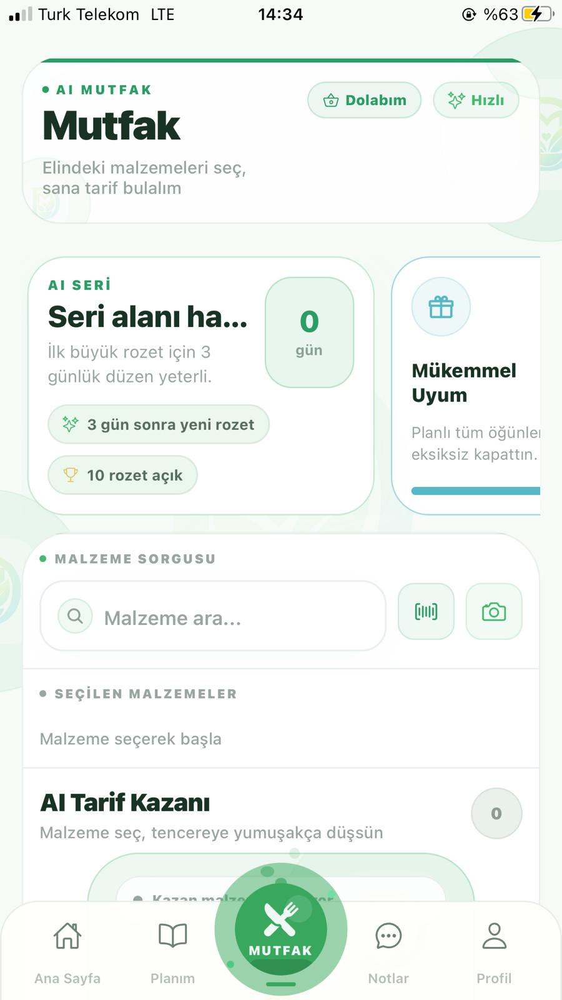
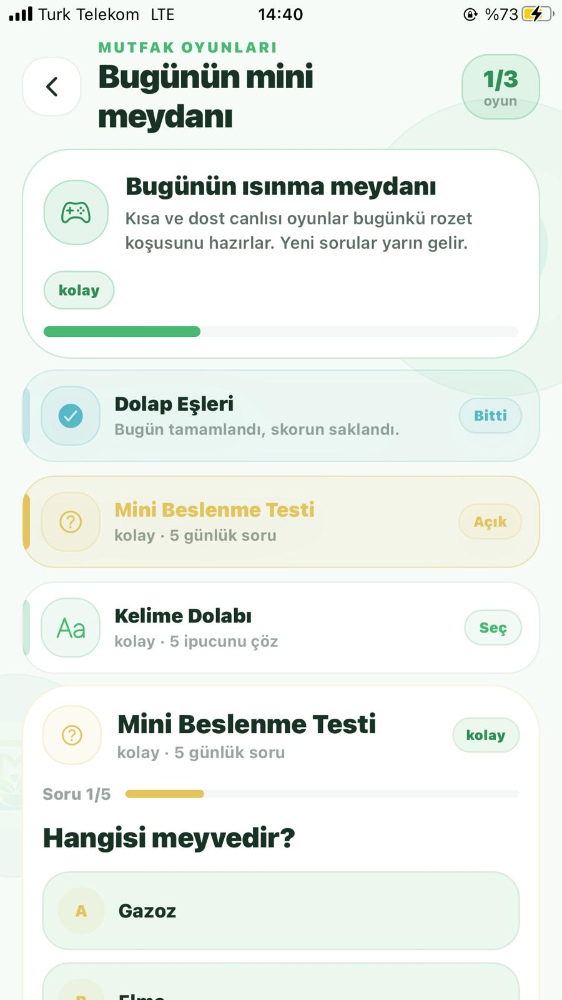
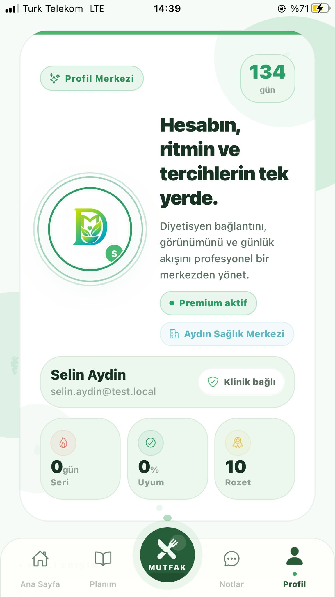
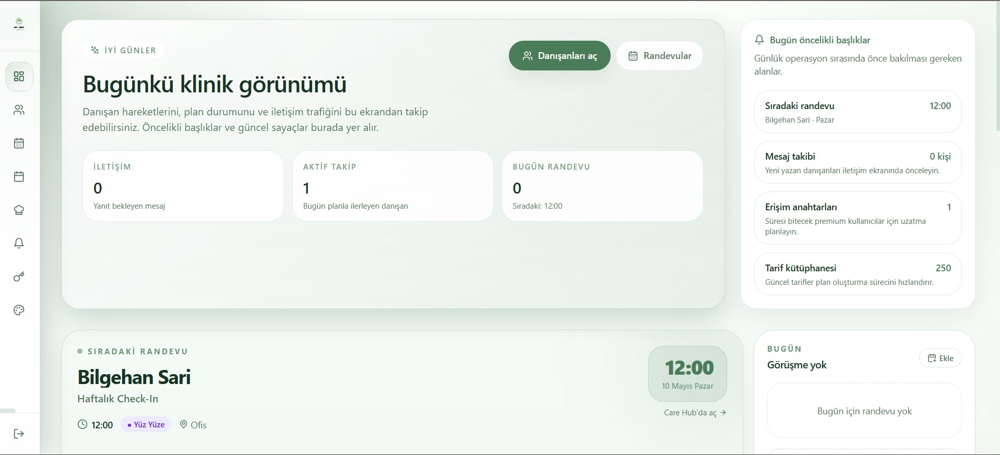
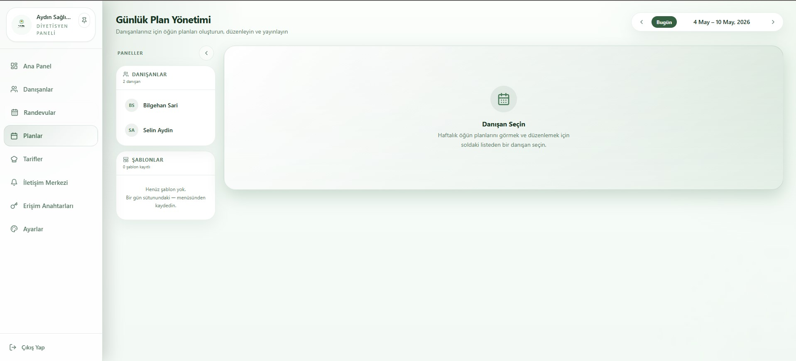
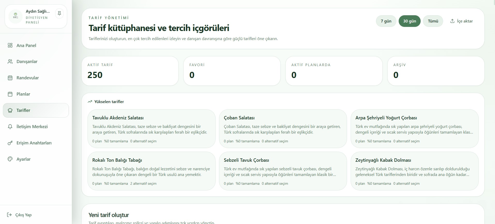
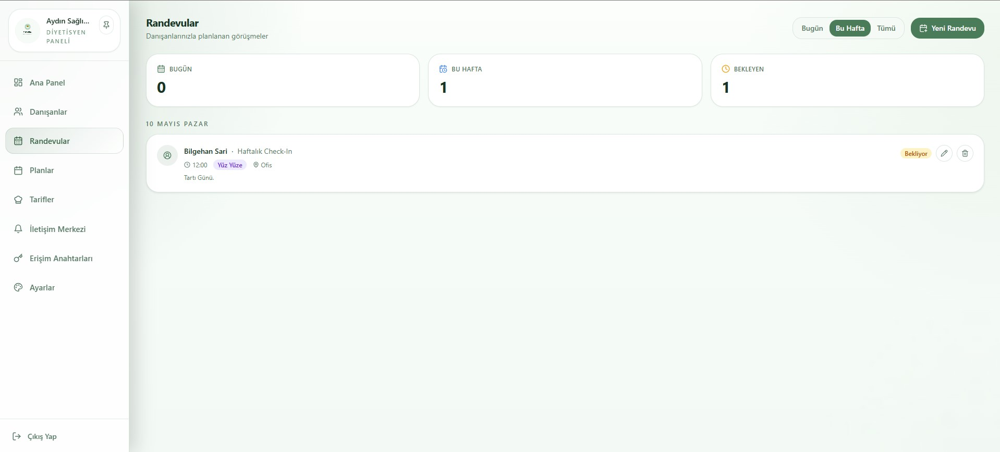
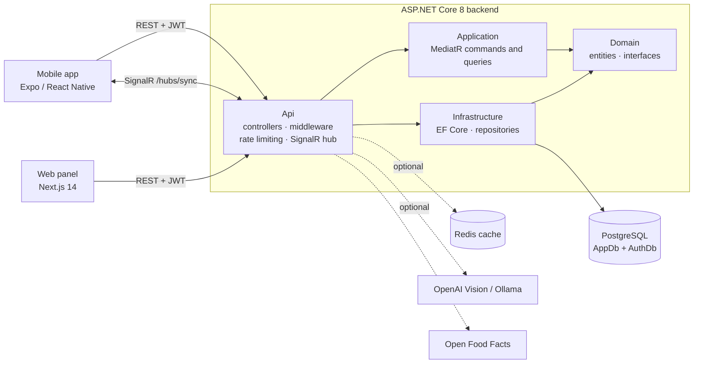
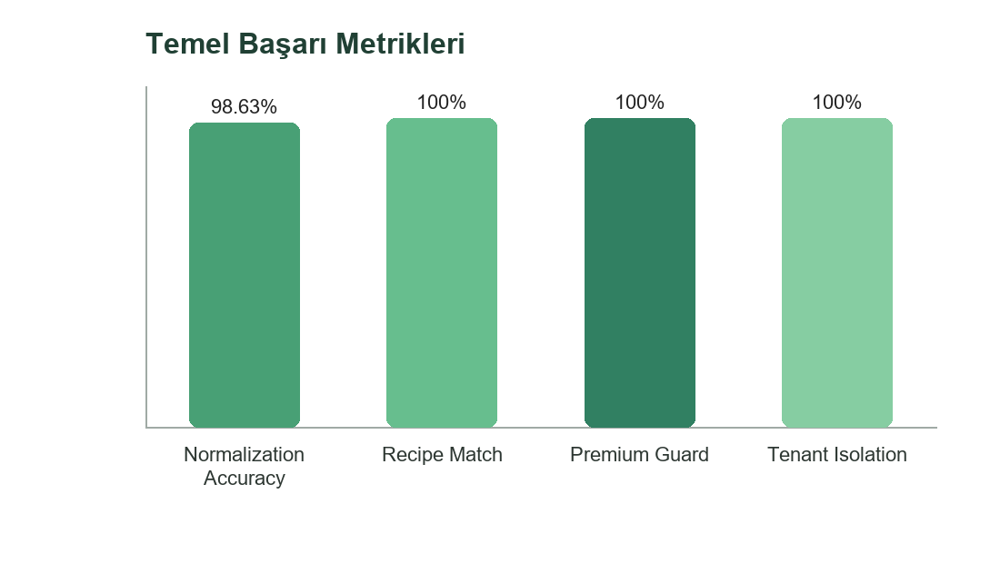

<p align="center">
  
</p>

<h1 align="center">Dytopia</h1>

<p align="center">
  <b>A freemium SaaS platform that connects dietitians and their clients.</b><br>
  Plans and client management on the web — daily tracking, smart kitchen tools and gamification on mobile.
</p>

<p align="center">
  
  
  
  
  
  
</p>

<details>
<summary><b>🇹🇷 Türkçe özet</b></summary>

**Dytopia**, diyetisyenler ile danışanlarını bir araya getiren, freemium modelli bir SaaS diyetisyen platformudur. Diyetisyenler web panelinden danışanlarını, diyet planlarını, tarif kütüphanesini ve erişim anahtarlarını yönetir. Danışanlar mobil uygulamada günlük planlarını takip eder, dolaplarındaki malzemelerden tarif önerisi alır, alışveriş listesi tutar, tabak taraması yapar ve oyunlaştırma ile motive olur.

Backend; **ASP.NET Core 8**, **Clean Architecture**, **CQRS/MediatR**, **PostgreSQL** ve **SignalR** ile geliştirilmiştir. Web panel **Next.js 14**, mobil uygulama **Expo / React Native** ile yazılmıştır. Projenin tez çalışması kapsamındaki ölçümlerinde malzeme normalizasyonu doğruluğu **%98,63**, tarif eşleştirme doğruluğu **%100** olarak raporlanmıştır (bkz. [Kalite ve benchmark](#-quality--benchmarks)).

</details>

---

## ✨ Overview

Dytopia gives dietitians a single place to run their practice and gives clients a companion app they actually want to open every day.

- **Dietitians** manage clients, build diet plans and meal-plan templates, curate a recipe library, issue access keys, message clients and track retention — all from a branded web panel.
- **Clients** follow today's plan, log meal compliance, manage their pantry, get recipe recommendations from what they already have, scan their plate, and stay motivated with achievements and daily challenges.
- Both sides stay in sync in real time through a **SignalR** hub.

The project was developed as a graduation project; its test and benchmark artefacts live under [`docs/thesis-finalization`](docs/thesis-finalization).

## 🚀 Highlights

| Area | What it does |
|---|---|
| **Access-key onboarding** | A dietitian generates an access key; the client activates it and is bound to that dietitian. Premium (freemium) features are gated by a dedicated authorization policy. |
| **Diet plans** | Plans, plan days and meals, reusable meal-plan templates, daily plan view and alternative-meal decisions. |
| **Recipe engine** | Recipe library with import sessions, ingredient substitutes, and a matching engine that recommends recipes from a client's pantry. |
| **Ingredient taxonomy** | Canonical ingredient names, aliases, families and normalization logs so messy real-world input resolves to the right ingredient. |
| **Smart kitchen** | Pantry (including receipt lines), shopping list, barcode lookup via Open Food Facts, and optional camera/vision-based ingredient recognition. |
| **Compliance & progress** | Per-meal compliance, daily compliance snapshots, weight and measurement tracking. |
| **Gamification** | Achievements, daily challenges and mini-games to keep clients engaged. |
| **Care hub** | Dietitian–client messaging, notes, announcements and appointment summaries. |
| **Branding & settings** | Per-dietitian branding, notification preferences, subscription settings, Turkish and English UI. |
| **Analytics** | Retention and reporting endpoints and dashboards for dietitians. |

## 📱 Screenshots

### Mobile app

<table>
<tr><td align="center" valign="top"><br><sub><b>Home</b></sub></td><td align="center" valign="top"><br><sub><b>My plan</b></sub></td><td align="center" valign="top"><br><sub><b>Kitchen</b></sub></td></tr>
<tr><td align="center" valign="top"><br><sub><b>Plate scan</b></sub></td><td align="center" valign="top"><br><sub><b>Pantry</b></sub></td><td align="center" valign="top"><br><sub><b>Shopping list</b></sub></td></tr>
<tr><td align="center" valign="top"><br><sub><b>Care hub</b></sub></td><td align="center" valign="top"><br><sub><b>Games</b></sub></td><td align="center" valign="top"><br><sub><b>Profile</b></sub></td></tr>
</table>

### Web panel

<table>
<tr><td align="center" valign="top"><br><sub><b>Dashboard</b></sub></td><td align="center" valign="top"><br><sub><b>Clients</b></sub></td></tr>
<tr><td align="center" valign="top"><br><sub><b>Diet plans</b></sub></td><td align="center" valign="top"><br><sub><b>Recipe library</b></sub></td></tr>
<tr><td align="center" valign="top"><br><sub><b>Recipe import</b></sub></td><td align="center" valign="top"><br><sub><b>Access keys</b></sub></td></tr>
<tr><td align="center" valign="top"><br><sub><b>Care hub</b></sub></td><td align="center" valign="top"><br><sub><b>Appointments</b></sub></td></tr>
</table>

## 🏗️ Architecture



The backend follows **Clean Architecture** with **CQRS** (commands, queries and handlers through MediatR). Two EF Core contexts keep application data (`AppDb`) and authentication data (`AuthDb`) separate.

### Security and reliability

- JWT bearer authentication with role policies (`Dietitian`, `Client`, `Admin`) and a premium-client policy.
- Named per-endpoint rate-limiting policies (authentication, key generation, vision, pantry, contact and more).
- Login lockout service, global exception middleware returning RFC 7807 `ProblemDetails`, and a `/health` endpoint.
- Background worker that expires premium subscriptions; premium changes are audit-logged.
- Tenant isolation and the premium guard are covered by automated tests (see benchmarks below).

## 🧰 Tech stack

| Layer | Technologies |
|---|---|
| **Backend** | C#, .NET 8, ASP.NET Core Web API, MediatR (CQRS), Entity Framework Core 8 + Npgsql, SignalR, JWT, Swagger / OpenAPI, optional Redis distributed cache |
| **Database** | PostgreSQL 15 (Docker), 40+ EF Core migrations |
| **Web panel** | Next.js 14 (App Router), React 18, TypeScript, Tailwind CSS, TanStack Query, react-hook-form + zod, next-intl (EN/TR), Playwright |
| **Mobile app** | Expo SDK 54, React Native 0.81, React 19, React Navigation, TanStack Query, SignalR client, expo-camera, expo-notifications, expo-secure-store |
| **Integrations** | Open Food Facts (barcodes), OpenAI Vision or Ollama (optional, off by default), Google sign-in |
| **DevOps** | Docker Compose (PostgreSQL + pgAdmin), Vercel-ready web panel, EAS build config for mobile |

## 📂 Project structure

```text
.
├── src/
│   ├── MyDietitianMobileApp.Api             # controllers, middleware, SignalR hub, rate limiting, workers
│   ├── MyDietitianMobileApp.Application     # CQRS commands, queries and handlers (MediatR)
│   ├── MyDietitianMobileApp.Domain          # entities, enums, repository and service interfaces
│   ├── MyDietitianMobileApp.Infrastructure  # EF Core (AppDb + AuthDb), migrations, repositories
│   └── MyDietitianMobileApp.Shared
├── tests/
│   ├── MyDietitianMobileApp.Api.Tests       # unit and integration tests
│   └── MyDietitianMobileApp.Api.SmokeTests  # smoke and API latency tests
├── web-panel/                               # Next.js dietitian / admin panel
├── mobile-app/                              # Expo / React Native client app
├── datasets/                                # Turkish ingredient and recipe seed data (CSV)
├── scripts/                                 # SQL seeds, smoke-test runner, tunnel helpers
├── docs/                                    # benchmark and finalization artefacts
└── docker-compose.yml                       # PostgreSQL 15 + pgAdmin
```

## 📊 Quality & benchmarks

<p align="center">
  
</p>

| Benchmark | Result |
|---|---|
| Ingredient normalization accuracy | **72 / 73 correct — 98.63 %**, 0 % false matches |
| Recipe matching engine | **36 / 36 correct — 100 %** |
| Premium guard | **100 %** |
| Tenant isolation | **100 %** |
| API latency — normalization | avg **42.24 ms**, p95 **59.43 ms** |
| API latency — recommendation | avg **2.13 ms**, p95 **2.67 ms** |
| Automated tests | **210 total · 203 passed · 0 failed · 7 skipped** |

Figures come from the project's finalization report generated on 2026-05-08 ([full report](docs/thesis-finalization/FINALIZATION_REPORT.md)). The optional OpenAI fallback was not exercised in that run because no API key was configured.

Test coverage spans authentication, dietitian workflows, recipes, pantry, gamification, games, taxonomy, ingredients and seeds, plus a smoke-test project and a Playwright end-to-end spec for the web panel.

## 🏁 Getting started

**Prerequisites:** [.NET 8 SDK](https://dotnet.microsoft.com/download), [Node.js](https://nodejs.org/) (LTS), [Docker](https://www.docker.com/), and the EF Core CLI (`dotnet tool install --global dotnet-ef`).

### 1. Start PostgreSQL

```bash
docker compose up -d
```

This starts PostgreSQL 15 on host port **5433** and pgAdmin on port **5050**.

### 2. Configure and run the API

The API reads two connection strings, `AppDb` and `AuthDb`, plus a `Jwt` section (see `src/MyDietitianMobileApp.Api/appsettings.Development.json`). Put machine-specific values and secrets in `appsettings.Local.json`, which is git-ignored.

```bash
# apply migrations for both contexts
dotnet ef database update --context AppDbContext  --project src/MyDietitianMobileApp.Infrastructure --startup-project src/MyDietitianMobileApp.Api
dotnet ef database update --context AuthDbContext --project src/MyDietitianMobileApp.Infrastructure --startup-project src/MyDietitianMobileApp.Api

# run the API
dotnet run --project src/MyDietitianMobileApp.Api
```

Swagger UI is available in development and `GET /health` reports API status. Optional AI features (image-based ingredient recognition) are disabled by default; enable them with `VisionIngredient:Enabled` and an `OPENAI_API_KEY` environment variable.

### 3. Run the web panel

```bash
cd web-panel
npm install
npm run dev
```

The panel talks to the API at `NEXT_PUBLIC_API_BASE_URL` (default `http://127.0.0.1:5000`). Keep any local credentials in an untracked env file.

### 4. Run the mobile app

```bash
cd mobile-app
npm install
npx expo start
```

Copy `.env.example` to `.env` and set `EXPO_PUBLIC_API_BASE_URL` to an address your device can reach (for the Android emulator that is `http://10.0.2.2:5000`).

### 5. Run the tests

```bash
dotnet test tests/MyDietitianMobileApp.Api.Tests         # unit and integration tests
bash scripts/run-smoke-tests.sh                          # API smoke tests
cd web-panel && npm run test:e2e                         # Playwright end-to-end
```

## 👤 Author

**Halil İbrahim Yıldırım** — .NET backend developer

[GitHub](https://github.com/devlightening) · [LinkedIn](https://www.linkedin.com/in/0001myprofile) · [Portfolio](https://portfol-io-xi.vercel.app) · ce.hybusiness@gmail.com
